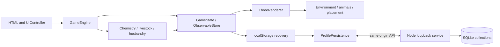

# Architecture

The browser owns simulation and rendering; the Node server stores snapshots and serves a restricted set of assets. Restarting the server does not independently advance a tank.

## Module map

| Module | Responsibility |
| --- | --- |
| `index.html`, `styles.css` | App structure, welcome screen and responsive layout |
| `js/main.js` | Bootstrap, persistence hydration and UI entry points |
| `js/engine/GameEngine.js` | Purchases, ticks, saves and render coordination |
| `js/engine/GameState.js` | Defaults, named profiles, snapshot loading and save hooks |
| `js/engine/ObservableStore.js` | State observation support |
| `js/model/WaterChemistry.js` | Chemistry, nitrogen cycling and nutrient effects |
| `js/model/LivestockEngine.js` | Animal creation, health and care rules |
| `js/model/Husbandry.js` | Food compatibility, meals, age, growth, decay and removal |
| `js/model/StoreService.js` | Catalogs, prices, eligibility and learning content |
| `js/model/SpeciesCatalog.js` | Physical sizes, growth and diet/movement metadata |
| `js/model/DecorCatalog.js` | Decor/background definitions and free-floor purchase placement |
| `js/model/TankGeometry.js` | Specs, outlines, volume and containment |
| `js/graphics/ThreeRenderer.js` | Scene, camera, lighting, visual clock and frames |
| `PhysicalEnvironment.js`, `TankBuilder.js` in graphics | Tank/equipment construction, cache and disposal |
| `LivestockRenderer.js`, `FishMotion.js`, `CleanupMotion.js` in graphics | Model lifecycle, size, animation and species movement |
| `Habitat.js`, `PlacementController.js`, `PlacementRules.js`, `CoralPlacement.js` in graphics | Surface queries, previews, validation, transforms and colony space |
| `js/ui/UIController.js`, `AquariumControls.js` | Panels, tank form, store and placement UI |
| `js/persistence/ProfilePersistence.js` | Recovery, queued writes, acknowledgements and conflicts |
| `server/index.js` | HTTP boundary, validation and SQLite persistence |

## Time and units

Simulation ticks advance chemistry, health, meals and maturation; speed controls affect this clock. Animation frames use active visual elapsed time so animals swim between chemistry ticks, while pause stops active motion. Keep these clocks separate: a frame must not apply a whole simulated-day consequence, and a swim animation must not wait for a chemistry tick.

One Three.js world unit equals one meter. The tank center is the origin, +Y is up, the bottom is `-height/2`, and the fill line leaves 0.025 m headspace. Models authored in arbitrary coordinates are measured and scaled to saved `lengthM`/`diameterM`. Raw artwork coordinates are not world dimensions.

`TankGeometry` is shared by displayed shapes, placement and movement boundaries. Preset capacities retain nominal 20/55/120-gallon gameplay rules; custom capacity uses shape/fill-line volume. Calculated liters do not subtract sand/rock displacement.

## Placement and lifecycle state

`placedItems` stores IDs, kind, optional template/livestock ID, position, normal, yaw in radians, current diameter and support ID. Resizing stores immutable `baseSize`; percentages refer to the original size, not the previous edit. Snapshots must not contain Three.js objects or resources.

Previews are temporary. Commit validates boundaries, collisions, contact and support before changing state. Dependent placements protect supporting rocks from move/resize. Recursive queries include decorative child geometry and recover its owning item ID. Artificial decor grants no biological live-rock credit.

Growth uses species limits and health/food/light conditions and changes actual rendered scale. A colony outgrowing support is marked Needs space rather than silently shrunk or moved. The tray is an abstraction; health continues. Cleanup health is per purchased cohort.

## Persistence and trust

SQLite's `collections` table holds browser identity, revision and a JSON payload of named profiles/active name. A random HttpOnly SameSite cookie selects the collection. This is local browser identity, not public user-account authentication.

LocalStorage keeps recovery and pending-write data. Startup reconciles remote state and eligible legacy/pending local changes, preserving conflicts as backup profiles. PUT requires the expected revision; stale writes are rejected. Local saves and database acknowledgements are distinct, including in UI status.

Snapshots are untrusted even when loaded locally. Validate payload structure and render stored values safely. See [security](../SECURITY.md), [operations](operations.md) and [the API contract](../server/openapi.yaml).

## Resource ownership and cost

Tank/equipment/rock/background signatures control environment rebuilds; coral growth alone must not rebuild static geometry. Bounds, habitat samples and textures are cached. Removed geometries/materials are disposed while shared textures retain their cache ownership. Profile switches clear stale animal meshes even if IDs coincide.

Pixel ratio/shadows are capped. Dense coral geometry still costs substantial work; comprehensive LOD/instancing is not implemented. Performance claims require a populated active scene and measured browser/hardware details.
